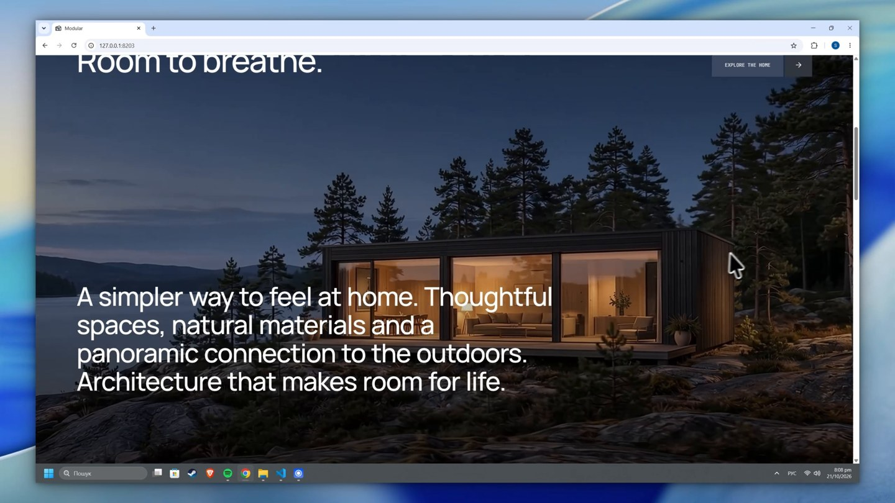

# Modular

An architectural concept website presenting a compact modular home. Built as a frontend portfolio project to explore product presentation, motion and visual storytelling.

[](https://github.com/Kredickoa/modular/raw/refs/heads/main/demo/demo.mp4)

[Watch the demo video](https://github.com/Kredickoa/modular/raw/refs/heads/main/demo/demo.mp4)

## Highlights

- A scroll-controlled architectural image sequence.
- An interactive GLB house model with detailed interior geometry.

## Stack

React 19, TypeScript, Vite, Tailwind CSS, Motion, GSAP and Google `<model-viewer>`.

## Run locally

Requires Node.js 22.12+ and npm.

```bash
npm ci
npm run dev
```

Create a production build with `npm run build`, then run `npm run preview` to preview it.

The 3D viewer loads Google's model-viewer module from a CDN.

Concept project, not a live commercial service. Any enquiry, cart or booking controls are demonstrations.

## Rights

All rights reserved. Shared for portfolio review; reuse requires prior written permission. See [LICENSE](LICENSE). Third-party materials retain their own licenses.
